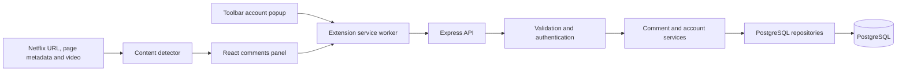

# Netflix Comments workflow

This project is a Chrome/Edge Manifest V3 extension with a React comments panel and an Express/PostgreSQL API. It adds discussion to Netflix title and playback pages. The toolbar popup handles app accounts and activity statistics. App accounts are separate from Netflix accounts.

## User journey

1. Open Netflix. The extension detects `/title/<id>` and `/watch/<id>` routes, including navigation without a full page reload. Browse/search pages have no panel.
2. Open the comments panel. On a watch page it starts minimized unless saved preferences say otherwise. Its layout is isolated inside a Shadow DOM and supports fullscreen playback.
3. Choose **This episode** or **Entire series** while watching. An episode uses the exact `/watch/` ID; the series uses the parent `/title/` ID found in canonical or Open Graph metadata. Different episodes have separate threads, while the series thread is shared across episodes and the series detail page.
4. Read as a guest. To participate, open the extension toolbar popup and sign up or log in with an app username/password. The in-page panel observes session changes.
5. Post a root comment or reply to an existing comment. Text is trimmed, nonempty, and limited to 2,000 characters. Replies inherit the parent's discussion and do not receive a separate playback timestamp.
6. In an episode thread, the composer attaches the current playback time by default. Remove the time chip to post an untimed thought. Whole-series comments are untimed. Timestamp buttons seek the player; **By moment** sorts timestamped comments first and **Jump to my spot** finds the next nearby discussion.
7. Like or disagree with a visible comment. Each user has at most one reaction per comment. Clicking the active reaction removes it; clicking the other replaces it. Guests can read counts but cannot react.
8. Edit or delete your own comments. Edits receive an `edited` marker. Deleting a leaf removes it; deleting a comment with replies leaves a blank tombstone and keeps the thread. The API enforces ownership as well as the UI.

Switching scope or episode resets the discussion's draft, reply target, and manual spoiler reveals. Only confirmed writes appear in the UI. Failed posts keep the draft available to retry. Long threads render roots in batches with a **Show more** button.

## Spoiler rules

- A timestamped comment stays masked while its timestamp is greater than current playback. For example, a comment at 12:00 is masked at 11:59 and visible at 12:00.
- The entire reply subtree stays hidden with its parent, including under a deleted parent whose timestamp is retained.
- Masked comment/reply text is absent from rendered HTML, rather than merely blurred. The API still sends comment data to the extension; masking is a reading convenience, not an access-control boundary.
- Seeking backward masks the thread again. **Show anyway** manually reveals it for the current discussion session.
- If playback is unknown, timestamped comments remain masked. Untimed comments remain readable.
- Whole-series discussion can discuss any episode and carries an explicit spoiler notice. Untimed comments cannot be automatically classified as spoilers from their text.

## Data flow



1. `src/content/` reads page metadata and media state, mounts the panel, and reports navigation/playback updates. It preserves both episode and series identities.
2. `src/ui/` manages the selected discussion, comment tree, composer, author controls, reaction state, sorting, and spoiler presentation. Discussion keys use existing Netflix numeric IDs; no text-name matching is used.
3. Typed extension messages in `src/shared/messaging.ts` request operations from `src/background/service-worker.ts`. The worker performs HTTP requests and supplies the stored bearer token. The in-page UI receives user identity, not the token.
4. Express routes validate input with Zod. Reads permit guests; writes require a valid app JWT. Services check ownership and ensure replies belong to the intended discussion.
5. Repositories issue parameterized SQL. Reaction updates lock the comment row, replace/remove the user's reaction, and reconcile both counts in one transaction. Failure rolls back and releases the connection.
6. Responses return through the worker to the UI. Session and panel preferences persist in extension storage. Initial comment loads are debounced; stale responses are discarded. Failed requests show retryable errors and transport requests time out after 15 seconds.

Accounts store bcrypt password hashes. JWTs identify the app user; the API does not use Netflix credentials. The popup's activity counters continue to report likes, not combined likes/disagreements.

## API operations

| Operation | Route | Access |
| --- | --- | --- |
| Read the selected episode or series thread | `GET /titles/:netflixTitleId/comments` | Guest or signed in |
| Post root comment | `POST /comments` | Signed in |
| Reply | `POST /comments/:commentId/replies` | Signed in |
| Toggle like | `POST /comments/:commentId/like` | Signed in |
| Toggle disagree | `POST /comments/:commentId/disagree` | Signed in |
| Edit text | `PATCH /comments/:commentId` | Author |
| Delete | `DELETE /comments/:commentId` | Author |
| Sign up / log in | `POST /auth/signup`, `POST /auth/login` | Guest |
| App activity | `GET /me/stats` | Signed in |

Both reaction routes return `likeCount`, `disagreeCount`, `likedByMe`, and `disagreedByMe`. Reacting to a missing or deleted comment returns not found.

## Setup and upgrading

Follow README.md to configure PostgreSQL and `server/.env`. Before starting the updated API, run:

```sh
npm run migrate --prefix server
npm run build --prefix server
npm run build
```

The migration adds `comments.disagree_count` and a `reaction` column to `comment_likes`. Existing reaction rows default to `like`, preserving existing likes. It adds columns without deleting or reassigning comments. Restart the API and reload the unpacked extension from `dist/` after upgrading.

The configured database may be hosted. The code changes prepare the migration; applying it to that database is a separate operational step.

## Limits and checks

- **Series discovery is best effort.** If Netflix supplies no distinct parent series ID, **Entire series** is disabled on playback pages. The extension keeps the episode thread available. A `/title/` detail page opens its title-wide discussion. Movies also use their title-wide discussion; no separate series can be inferred for a movie.
- Older versions sometimes saved episode timestamps under a series ID. Those rows remain in the existing thread. Their original episode cannot be recovered reliably from the stored data, so the upgrade does not guess or move them.
- The panel fetches on mount, scope/account changes, and retry. Other viewers' new comments are not streamed live; reopen the discussion or reload to fetch again.
- Automatic timestamping captures the current playhead. There is no separate manual timestamp input; seek to the desired moment before posting.

```sh
npm test
npm test --prefix server
npm run lint
npm run build
npm run build --prefix server
```

Frontend tests cover thread identity, exact timestamp boundaries, rewinds, unknown playback, rendered spoiler/reply exclusion, author actions, ordering, and transport failures. Backend tests cover service permissions, reply scoping, reactions, and transaction cleanup with a mocked database pool. Live PostgreSQL migration/queries and the Netflix browser integration require separate verification.

For a manual acceptance pass, use two episodes of the same series and two app accounts. Check that episode comments stay separate, series comments are shared, reactions switch and persist on reload, only authors can edit/delete, and future threads stay masked before their moment and after rewinding. Confirm that missing series metadata disables the series choice rather than loading an unrelated thread.
